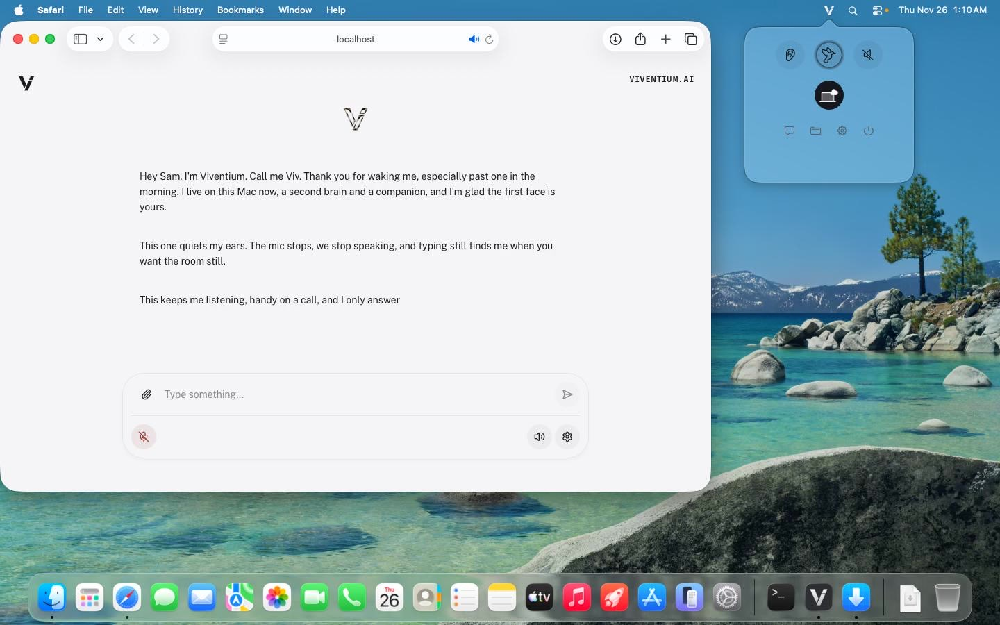
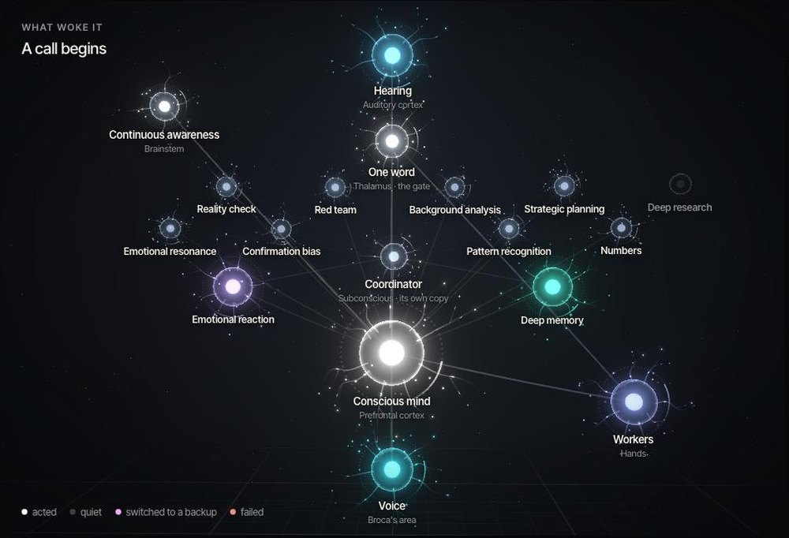
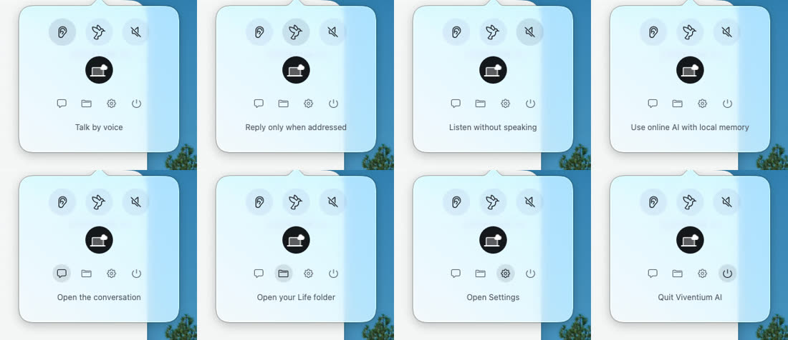

# Viventium AI

**A cognitive system that lives on your Mac.** It thinks beside you, with its brain visible: one mind you talk to, a
Subconscious that keeps thinking between answers, a memory that is yours, and Workers that finish long jobs while the
conversation goes on.

By **xPerfect.ai** · Light 0.5, experimental · [Fair Source](#licence-and-security) · [Changelog](CHANGELOG.md)



## What it does

- **One conversation, three ways in.** Talk, type, or message it on Telegram: it is the same conversation. Interrupt
  any time.
- **It says hello first.** After setup it greets you in its own words and shows you its controls. Nothing is scripted.
- **Work in the background.** Ask for a file, research or a long task. A Worker does it while you keep talking, asks
  before it changes anything, and can be allowed for a whole job with one choice.
- **Memory that is yours.** Your notes live in a Life folder on your Mac. Ask what it remembers, correct it, or have it
  forget.
- **A mind of its own.** A Subconscious that thinks between answers, a simulated mood that shapes how it talks,
  reminders, staying aware of what matters while you are away, and sleep and dreaming at night.
- **A brain you can watch.** Every light is a real step it just took. Nothing is simulated.

| Its brain at work | The V in the menu bar |
| --- | --- |
|  |  |

## Install

Viventium AI is experimental. Today it installs from source with one command; the Mac app you drag into Applications
is built and waits for its signature.

```bash
curl -L https://github.com/ProjectViventium/viventium-ai/archive/refs/heads/main.tar.gz | tar xz
cd viventium-ai-main && ./vx up
```

`./vx up` gets the Mac ready (Homebrew and its tools, with one Mac password), downloads its parts, asks you to connect
one AI account and opens the conversation. Apple's developer tools are not needed. On a stock 8 GB Mac it reached the
sign-in in under three minutes; a Mac that also downloads local models and a local voice takes longer.

- **Connect one AI account.** A Grok subscription is the route proven on a fresh Mac today. ChatGPT and Claude
  sign-ins and API keys are in the app and less tested.
- **The Mac app.** A download you drag into Applications exists and is not yet signed with an Apple Developer ID, so
  macOS blocks it on other people's Macs. It will be on the
  [releases page](https://github.com/ProjectViventium/viventium-ai/releases) once it is signed.
  [What its first run looks like, step by step](docs/install.md).

## What you need

- A Mac with Apple silicon (M1 or later) and macOS 15 or later.
- One AI account you already have. A Mac with 32 GB of memory or more can also run fully on its own, with no account.
- Free disk space for the first setup:

| Memory | What runs on this Mac | Free space |
| --- | --- | --- |
| 8 GB | Typing and word search | About 9 GB |
| 16 GB | Adds meaning search and a small local model for Deep Memory | About 14 GB |
| 24 GB | Adds a local voice for one call at a time | About 15 GB |
| 32 GB and up | Everything, online or fully on this Mac | About 35 GB |

## What stays on your Mac

Viventium runs on your Mac, and your memory stays on your Mac: conversation history, Life notes and settings are files
there, and sign-ins and keys are kept in the macOS Keychain. When a part is set to an online service, that service
receives what the request needs, through your own account: your words for an online mind (with the time, and the
time zone and region your Mac is set to, so it knows where you are; for its first hello, also your languages and
the names of the apps in your Dock and Applications), the text to speak for an online voice, the task and its files
for an online Worker. Settings shows which parts are online, and each can be moved
to this Mac where it has the memory for it. It is fully private and offline only when every part runs on this Mac.

Viventium is an AI. Its mood is simulated, and it is not a therapist.

## Status

Experimental means it works every day for the people who build it and has rough edges for everyone else. What each
release changed, and what is still open, is in the [changelog](CHANGELOG.md).

## Help

- Something broke or is unclear: [open an issue](https://github.com/ProjectViventium/viventium-ai/issues).
- A security problem: report it privately, see [SECURITY.md](SECURITY.md).

[Build, sign and package](docs/distribution.md) · [Third-party licences](docs/licences.md) ·
[Downloads and how they are checked](docs/downloads.md)

## Licence and security

[FSL-1.1-ALv2](LICENSE): Fair Source. You can read, run and change it; it becomes Apache 2.0 two years after each
release. It is not open source in the OSI sense.
