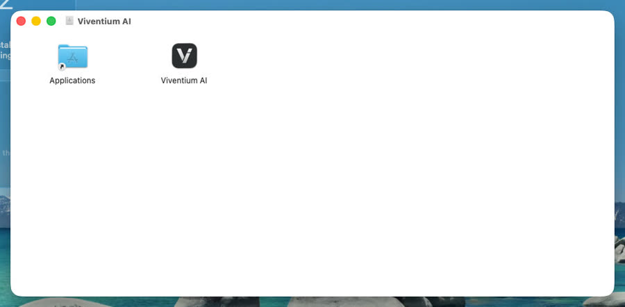
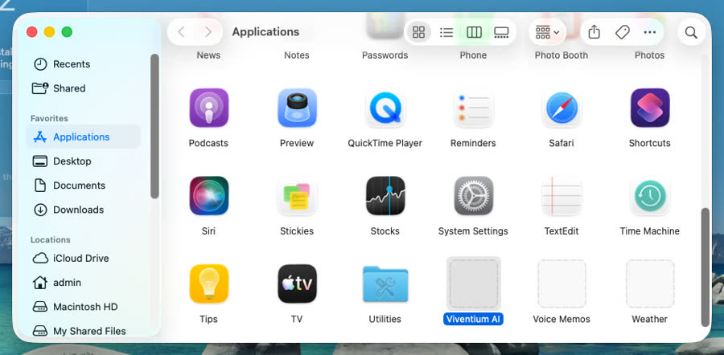
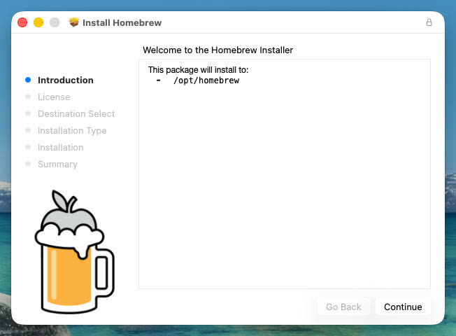
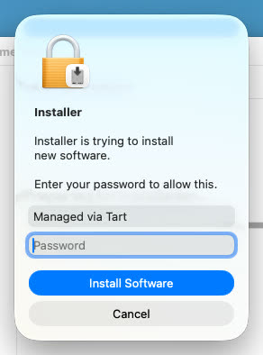
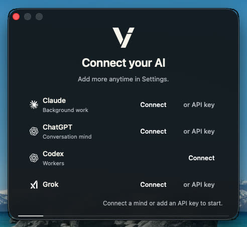
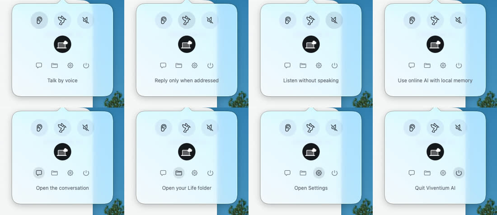
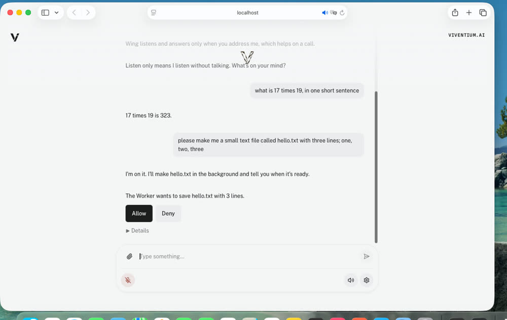
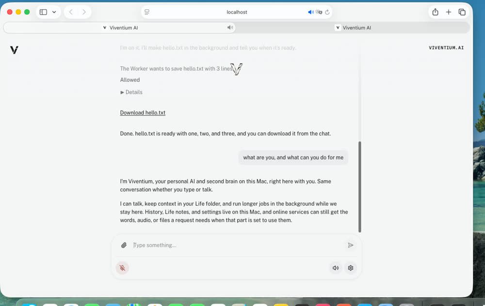
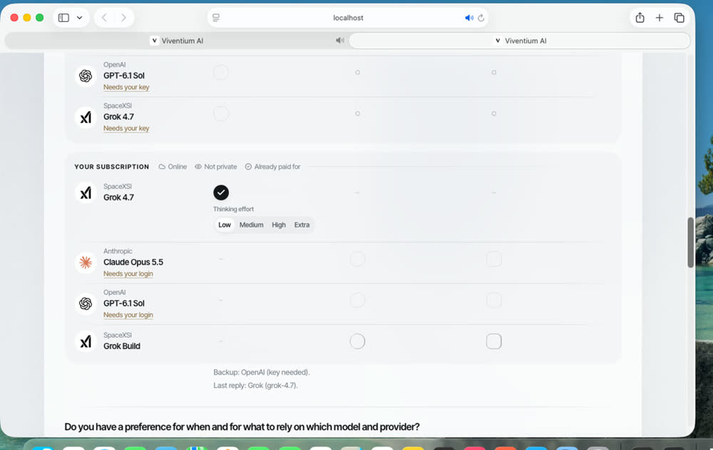
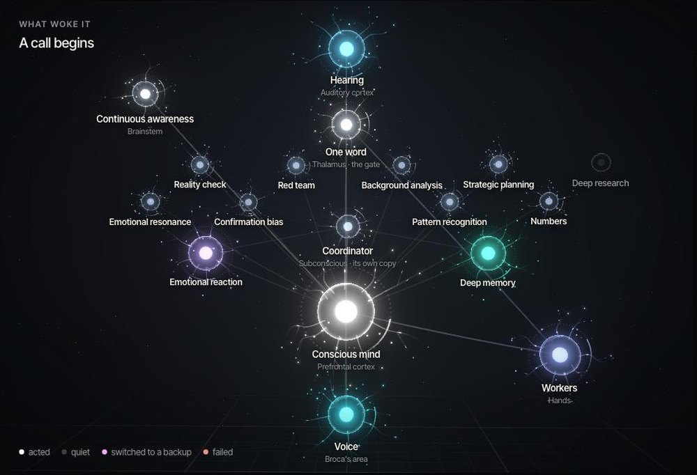

# Install Viventium AI

Your first conversation, with a picture of each step.

**Today, install from source** with the one command in the [README](../README.md#install): it does everything from
step 2 on by itself, in a terminal, and asks for your Mac password and your AI account there.

**The Mac app** shown below is built and not yet signed with an Apple Developer ID, so there is no download of it yet.
These are its steps as recorded on a clean Mac; they will be the way to install once it is signed.

## 1. Download and open (the Mac app, once it is signed)

Open the download and drag **Viventium AI** onto **Applications**.

Open **Viventium AI** from Applications, Launchpad or Spotlight. macOS asks once whether to open an app downloaded from
the internet: choose **Open**.

## 2. Let the Mac get ready

Viventium checks this Mac and installs the tools it needs. macOS opens Homebrew's installer: choose **Continue**,
**Agree** and **Install**, then type your Mac password when macOS asks. Homebrew is a common, signed tool installer;
Viventium uses it for the pieces every Mac lacks.

| Homebrew's installer | Your Mac password |
| --- | --- |
|  |  |

The downloads then run by themselves. A thin line under the window shows how far they are.

## 3. Connect your AI

Choose one account you already have and press **Connect**: Grok, ChatGPT or Claude. Your browser opens that
provider's own sign-in page; approve it there and come back. An API key works too. You can add more later in Settings.

On a Mac with 32 GB of memory or more, Viventium can also start with no account and run fully on the Mac.

## 4. Say hello

When everything is ready, the conversation opens by itself. Viventium asks you one short question, by name, and waits
for your answer: type, or press the microphone and talk. Then, unless your answer starts some work, it tells you about
Wing and Settings, lighting each in the menu bar's panel.

Some browsers keep a page silent until you click on it. If yours does, the page shows **Turn on sound**: click it
(or click anywhere on the page, or start typing) and Viventium says hello. It waits for you rather than speak
into silence.

For that first question, Viventium uses your name on the Mac (or your connected account's name), with the time, the
time zone and the region your Mac is set to. It asks for no permission and opens no file. These go to the mind
Viventium runs on (the one you connected, or the model on this Mac).

## The V in the menu bar

The V opens a small panel. Point at any control and a line under the icons says what it does.

## Work in the background

Ask for something that takes work, such as a file. Viventium says it has taken the job on and keeps talking with you.
Before a Worker changes anything, it asks in one plain sentence: choose **Allow** or **Deny**. The result arrives in
the conversation.

A long job can ask many times. A third choice covers the rest of that job for the kinds it names, for example
**Allow commands and file edits for this job** (a command can change files too); any other kind is still asked, and so
is any request whose effect cannot be shown. If nobody answers in time, Viventium refuses the request for you just
before it would expire and tells you, on the request itself or with the job's result if you were away. A refused
Worker usually stops there, so the result says the work may be unfinished. A long job finishes with you away only when
everything it asks is of a kind you allowed for the job.

| Asking first | The result |
| --- | --- |
|  |  |

## Settings

Open Settings from the V panel. Every choice is its own control and saves itself: voice, mind, Workers, memory,
personality and channels such as Telegram.

In Settings, **Subconscious** shows what Viventium does on its own, beside your conversation. **View live** lights
each part as it works: hearing, its conscious mind, memory, Workers and the rest.

## If something stops

| What you see | What it means | What to do |
| --- | --- | --- |
|  | The Mac needs more free space for the first setup. | Free up the amount shown. Viventium goes on by itself. |
|  | A setup step did not finish. The window says which. | Press **Try again**. Setup goes on from where it stopped. |

Still stuck? The window's one line names the step; include it when you ask for help.

## Later

- **Start at login:** Settings, System.
- **Turn off:** the power control in the V panel. Viventium rests until you open the app again.
- **Installed from source:** the viventium-ai-main folder holds Viventium's conversation history and settings, so keep
  it where it is. `./vx up` in that folder starts Viventium, and `./vx backup` keeps a checked copy outside it.
- **Remove:** turn off start at login, turn Viventium off, then move Viventium AI from Applications to the Bin. Your Life notes,
  sign-ins and Viventium's own data folder (installed from source, the viventium-ai-main folder) stay on the Mac until
  you delete them.
